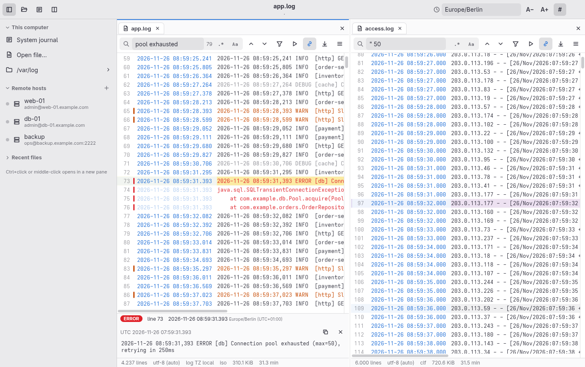

# GLViewer

A fast log viewer for the GNOME desktop (and, through Electron, also Windows and macOS).



## Install

* **Flatpak**: download `GLViewer-vX.Y.Z-x86_64.flatpak` from the [releases page](https://github.com/wpichler/glviewer/releases), then:
  ```sh
  flatpak install --user GLViewer-vX.Y.Z-x86_64.flatpak
  ```
  The runtime is installed from Flathub automatically. Updates: install the newer bundle the same way.
  The Flatpak runs sandboxed. Opening files as administrator is not available there (see [Packaging](#packaging)).
  GLViewer is not available on Flathub.
* **Other Linux**: AppImage, `.deb`, `.rpm` or `.tar.gz` (x86_64 and arm64) from the releases page.
* **Arch Linux**: package files for the AUR (`glviewer-bin`) are in [packaging/aur](packaging/aur).
* **Windows / macOS**: installer / `.dmg` from the releases page. These builds are unsigned, so the OS will warn before the first start.

## AI-generated code

GLViewer was written almost entirely by an AI coding agent (Anthropic's Claude, used through Claude Code) under the direction of the maintainer. That covers the application code, the tests, the packaging (electron-builder config, Flatpak manifest, CI workflows), this README, the icon and the demo screenshot. Please keep this in mind when evaluating it, and report problems via the [issue tracker](https://github.com/wpichler/glviewer/issues).

## Features

* **systemd journal**: local or remote. Filter by boot, units, priority, time range, kernel messages, server-side grep; live follow; optional `pkexec` (local) or `sudo` (remote).
* **Local log files**: plain, `.gz` and `.zst`. Encoding is auto-detected (BOM, UTF-8/16, chardet) and can be changed. Files that need root can be opened via `pkexec`.
* **Remote hosts via SSH**: hosts come from `~/.ssh/config` or are added in the app. You can browse `/var/log` (falling back to sudo where permissions require it), open any path, and query the remote journal. Authentication tries the SSH agent, then keys, then password / keyboard-interactive. Host keys are verified against `~/.ssh/known_hosts`, and you are asked to confirm unknown keys.
* **Syslog receiver**: receive logs from routers, servers and other devices over UDP and/or TCP on a configurable port (default 1514). Supports RFC 5424 and BSD syslog (RFC 3164), and both TCP framings (octet counting and newline). The dialog shows a ready-to-use rsyslog line for the senders.
* **Viewer**:
  * Virtual scrolling with millions of lines (3M lines / 286 MB loads in ~2 s, filters in ~100 ms).
  * Search with highlighting, regex and case sensitivity.
  * Filters: include and exclude text, severity levels, time range, journal unit and host.
  * Side-by-side panes with **time-synchronized scrolling**.
  * Normalized timestamps in a selectable **display time zone**, and a per-file **log time zone** for timestamps that carry no offset. The remote host's zone is detected automatically.
  * Timestamp format auto-detection: ISO 8601, syslog, Apache/CLF, ctime, nginx, Tomcat, epoch/audit.
  * Live tail, export, copy.

## Development

Requires Node.js 22.

```sh
npm install
npm run dev          # start with hot reload
npm test             # unit tests (core parsing, filtering, ssh helpers, follow)
npm run typecheck
```

Open files from the command line with `npx electron . file1.log file2.log` (each opens in its own pane), or open the journal with `--journal`.

## Packaging

```sh
npm run dist:linux   # AppImage, rpm, deb  (rpm needs rpmbuild)
npm run dist:win     # NSIS installer
npm run dist:mac     # dmg (on macOS)
npm run dist:flatpak # Flatpak built from source, offline; needs org.flatpak.Builder (flathub)
```

The Flatpak is built entirely from source and offline: npm dependencies and the Electron runtime come from `flatpak/generated-sources.json`. After changing dependencies run `npm run flatpak:sources`; CI fails if the file is out of date. It also bundles its own `journalctl` (built from systemd) and reads the journal inside the sandbox.

Flatpak permissions, all read-only except network:

* `/var/log` (log browser and persistent journal), `/run/log/journal` (volatile journal), `~/.ssh` (SSH config, `known_hosts`, keys), plus network, SSH agent and display.
* Other files are opened through the file chooser, drag & drop or "Open with" (document portal), not with general file system access.
* No access to the host system. You see the system journal if your user may read it outside the sandbox too: on most distributions, members of `wheel`, `adm` or `systemd-journal`. Otherwise you see your own user journal.
* "As administrator" (`pkexec`) is not available. To enable it, allow GLViewer to talk to `org.freedesktop.Flatpak` (e.g. with Flatseal). The AppImage and distribution packages have no such limitation.

## Layout

```
src/main/core      LogDoc (lines + columnar timestamps/levels, filter, search, time lookup),
                   timestamp parsers, time zone conversion, encoding detection
src/main/sources   files (load, gzip, pkexec, tail), journal (journalctl JSON), ssh (ssh2), ssh config / known_hosts
src/renderer       React UI: virtualized LogView, panes, filter bar, sidebar, dialogs
```

Keyboard: `Ctrl+F` search, `F3` / `Shift+F3` next/previous match, `Ctrl+L` filter bar, `Ctrl+C` copy selected lines, `Shift+click` / `Shift+arrows` extend the selection.
